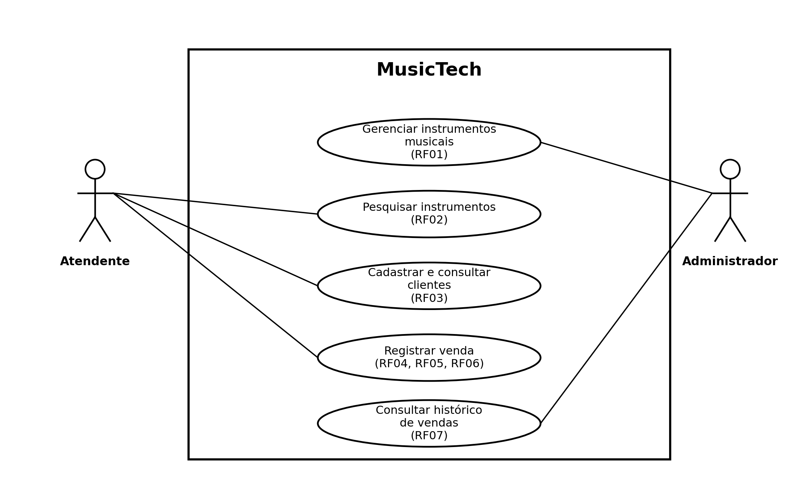

# 4.2.2 Modelagem de Casos de Uso

<!--
Esta seção responde: quem usa o sistema, para quê, e passo a passo como o caso de uso principal acontece?

São cinco blocos, na ordem em que aparecem. Cada tabela já tem a primeira linha começada.
Troque o que está em itálico pelo seu texto e acrescente linhas até o teto:
4 a 6 casos de uso, com um especificado. O nome de cada elipse é o nome do RF que ela atende.

O diagrama vai em dois arquivos com o mesmo nome: diagramas/casos-de-uso.drawio (para editar) e diagramas/casos-de-uso.png (para aparecer aqui).

A mesma seção pronta, do BiblioTech, está em exemplo-bibliotech/docs/4.2.2-casos-de-uso.md
no repositório do modelo, com o diagrama em exemplo-bibliotech/diagramas/casos-de-uso.png. O BiblioTech mostra a forma. As frases têm de ser suas.

Quando terminar, pode apagar estes comentários.
-->

## Atores

<!-- Um ator por papel, nunca por pessoa. Ator é quem opera o sistema, não quem se beneficia.
     O ponto de partida é o bloco "Quem usa" da sua 4.1. -->

| Ator | Quem é | O que faz no sistema |
|---|---|---|
| Atendente | 	Funcionário responsável pelo atendimento na loja. | Cadastra e consulta clientes, pesquisa instrumentos e registra vendas. |
| Administrador | Responsável pelo gerenciamento da loja. | Cadastra, edita e remove instrumentos, gerencia o estoque e consulta o histórico de vendas. |

## Casos de uso

<!-- 4 a 6 casos de uso. O nome é o nome do RF da sua 4.2.1 (verbo mais objeto), igual letra por letra.
     Um caso de uso pode atender mais de um RF. Um RF que é passo de outro (um cálculo, uma verificação) não vira elipse:
     diga onde ele mora na rastreabilidade, no fim. -->

| Caso de uso | Ator | Atende |
|---|---|---|
| Gerenciar instrumentos musicais | Administrador | RF01 |
| Pesquisar instrumentos | Atendente | RF02 |
| Cadastrar e consultar clientes | Atendente | RF03 |
| Registrar venda | Atendente | RF04, RF05, RF06 |
| Consultar histórico de vendas| Administrador | RF07 |

## Diagrama de casos de uso

<!-- Desenhe no draw.io. Fronteira com o nome do sistema, atores fora, elipses dentro, linha ator e caso de uso sem ponta.
     «include» e «extend» só se houver um passo compartilhado por dois ou mais casos, ou algo que acontece só às vezes.
     Salve diagramas/casos-de-uso.drawio e exporte diagramas/casos-de-uso.png. Legenda acima, fonte abaixo, e a figura descrita no texto. -->

**Figura 1 – Diagrama de casos de uso do MusicTech.**

Fonte: Autoria própria (2026).

A Figura 1 apresenta o diagrama de casos de uso do sistema MusicTech. Os atores Atendente e Administrador estão representados fora da fronteira do sistema, enquanto os casos de uso estão dentro dela. O Atendente pode pesquisar instrumentos, cadastrar e consultar clientes e registrar vendas. Já o Administrador pode gerenciar instrumentos musicais e consultar o histórico de vendas. O diagrama não apresenta relações «include» ou «extend», pois não foram identificados passos compartilhados entre os casos de uso nem funcionalidades opcionais que justifiquem essas relações.

## Especificação do caso de uso principal

<!-- Escolha o caso de uso que o sistema existe para fazer.
     Pré-condição: o que precisa ser verdade antes. Pós-condição: o que fica verdade depois.
     Fluxo principal: passos numerados, indo e voltando (o ator informa, o sistema responde), um verbo por passo, sem tela nem botão.
     Alternativo: outro caminho que ainda chega ao fim. Exceção: o caso termina sem a pós-condição. -->

O caso de uso “Gerenciar instrumentos musicais” foi escolhido como principal porque permite que o administrador mantenha os instrumentos da loja cadastrados e organizados. Esse gerenciamento é importante para o controle do estoque e para que os atendentes possam consultar os instrumentos disponíveis e registrar as vendas corretamente.

| Campo | |
|---|---|
| Caso de uso | Gerenciar instrumentos musicais |
| Ator | Administrador |
| Pré-condição | O administrador deve estar autenticado no sistema. |
| Pós-condição | As informações dos instrumentos ficam atualizadas no sistema, conforme a operação realizada (cadastro, edição ou remoção). |

**Fluxo principal**

1. O administrador solicita o cadastro de um instrumento.
2. O sistema solicita os dados do instrumento.
3. O administrador informa o nome, tipo, marca, modelo, preço e quantidade em estoque.
4. O sistema verifica os dados informados.
5. O sistema registra o instrumento.
6. O sistema confirma o cadastro do instrumento.

**Fluxo alternativo**

- **A1, no passo 1: O administrador deseja editar um instrumento já cadastrado.** O sistema solicita a identificação do instrumento. O administrador informa qual instrumento deseja editar. O sistema apresenta os dados atuais. O administrador informa os novos dados. O sistema verifica e atualiza as informações do instrumento. O fluxo retorna ao passo 6 do fluxo principal, confirmando a atualização.

**Fluxos de exceção**

- **E1, no passo 4: O administrador informa dados obrigatórios incompletos ou inválidos.** O sistema identifica os problemas e informa que os dados precisam ser corrigidos. O cadastro não é realizado e o caso de uso termina sem a pós-condição.

## Rastreabilidade com a 4.2.1

<!-- Todo RF da sua 4.2.1, um por linha. Diga a elipse que o atende ou, se ele não virou elipse, onde ele mora.
     Depois responda as três perguntas. -->

| Requisito | Caso de uso | Onde aparece |
|---|---|---|
| RF01 – Gerenciar instrumentos | Gerenciar instrumentos musicais | Fluxo principal (cadastro), fluxo alternativo (edição). A consulta e a remoção ainda não foram detalhadas na especificação |
| RF02 – Pesquisar instrumentos | Pesquisar instrumentos | Elipse do diagrama |
| RF03 – Cadastrar e consultar clientes | Cadastrar e consultar clientes | Elipse do diagrama |
| RF04 – Registrar venda | Registrar venda | Elipse do diagrama |
| RF05 – Atualizar estoque automaticamente | Registrar venda | Etapa interna da realização da venda |
| RF06 – Impedir venda sem estoque suficiente | Registrar venda | Verificação durante o registro da venda |
| RF07 – Consultar histórico de vendas | Consultar histórico de vendas | Elipse do diagrama |
| RF08 – Controlar acesso por perfil | Nenhum caso de uso específico | Condição de acesso às funcionalidades, conforme o perfil autenticado |

Todo requisito tem lugar? Sim. Todos os requisitos estão relacionados a um caso de uso ou a uma condição/etapa interna do sistema. Porém, RF01 ainda precisa contemplar consulta e remoção na especificação.

Toda elipse tem requisito? Sim. As cinco elipses do diagrama estão relacionadas a requisitos funcionais.

O que a especificação mudou? A especificação detalhou o gerenciamento de instrumentos, apresentando o cadastro no fluxo principal, a edição no fluxo alternativo e o tratamento de dados incompletos ou inválidos no fluxo de exceção.
