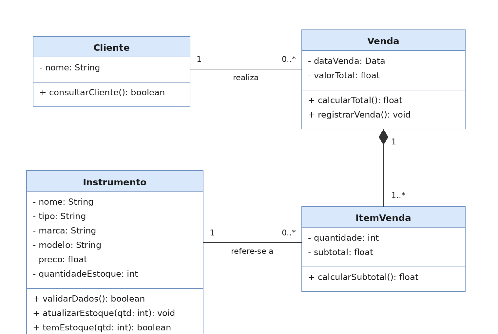

# 4.2.3 Modelagem de Classes

## Dos substantivos às classes

| Substantivo | De onde veio | Vira | Por quê |
|---|---|---|---|
| Instrumento | RF01 e passo 5 do fluxo principal | Classe Instrumento | Representa os instrumentos cadastrados e gerenciados pelo sistema |
| Nome | RF01 e passo 3 do fluxo principal | Atributo de Instrumento | É uma informação usada para identificar o instrumento |
| Tipo | RF01 e passo 3 do fluxo principal | Atributo de Instrumento | Informa a categoria do instrumento |
| Marca | RF01 e passo 3 do fluxo principal | Atributo de Instrumento | Identifica a marca do instrumento |
| Modelo | RF01 e passo 3 do fluxo principal | Atributo de Instrumento | Identifica o modelo do instrumento |
| Preço | RF01 e passo 3 do fluxo principal | Atributo de Instrumento | Informa o valor de venda do instrumento |
| Quantidade em estoque | RF01, RF05 e RF06 | Atributo de Instrumento | Informa quantas unidades estão disponíveis para venda |
| Cliente | RF03 e RF04 | Classe Cliente | Representa as pessoas cadastradas que realizam compras |
| Venda | RF04 e RF07 | Classe Venda | Representa uma operação de venda registrada pelo sistema |
| Data da venda | RF04 e RF07 | Atributo de Venda | Registra quando a venda foi realizada |
| Item da venda | RF04 | Classe ItemVenda | Representa cada instrumento e sua quantidade dentro de uma venda |
| Quantidade da venda | RF04 e RF05 | Atributo de ItemVenda | Informa quantas unidades de um instrumento foram vendidas |
| Atendente | RF04 e RF08 | Nada | É um ator que utiliza o sistema, não uma entidade necessária nesta modelagem |
| Administrador | RF01, RF07 e RF08 | Nada | É um ator que utiliza o sistema, não uma entidade necessária nesta modelagem |
| Histórico de vendas | RF07 | Nada | É uma consulta às vendas registradas, não uma entidade independente |

## Classes

Quatro classes, dentro do limite de quatro a seis. Três faixas em cada uma: o nome no singular com inicial maiúscula, os atributos no formato `nome: tipo`, e as operações com parênteses. Cada atributo e cada operação têm uma origem na coluna da direita, garantindo a rastreabilidade com a especificação.

Para evitar atributos sem respaldo na especificação, `Cliente` mantém apenas a identificação básica de cadastro prevista no RF03, sem inventar campos extras não detalhados nos requisitos. Da mesma forma, `Atendente` e `Administrador` ficaram fora do diagrama de classes por atuarem apenas como atores externos que operam o sistema.

| Classe | Atributos | Operações | Veio de |
|---|---|---|---|
| **Instrumento** | `- nome: String`, `- tipo: String`, `- marca: String`, `- modelo: String`, `- preco: float`, `- quantidadeEstoque: int` | `+ validarDados(): boolean`, `+ atualizarEstoque(qtd: int): void`, `+ temEstoque(qtd: int): boolean` | RF01 e passo 3 (dados cadastrados), passo 4 e exceção E1 (validação), passo 5 e fluxo A1 (registro e edição), RF05 e RF06 (baixa e verificação de estoque) |
| **Cliente** | `- nome: String` | `+ consultarCliente(): boolean` | RF03 (cadastro e consulta de clientes), RF04 (vinculação à venda) |
| **Venda** | `- dataVenda: Data`, `- valorTotal: float` | `+ calcularTotal(): float`, `+ registrarVenda(): void` | RF04 (registro da venda), RF07 (data para consulta do histórico de vendas) |
| **ItemVenda** | `- quantidade: int`, `- subtotal: float` | `+ calcularSubtotal(): float` | RF04 (itens vinculados à venda), RF05 (quantidade vendida para baixa no estoque) |

## Diagrama de classes

**Figura 2 – Diagrama de classes do MusicTech**

Fonte: Autoria própria (2026).

A Figura 2 apresenta o diagrama de classes do sistema MusicTech, composto pelas quatro classes definidas na seção anterior (`Cliente`, `Venda`, `ItemVenda` e `Instrumento`), representadas em caixas de três faixas com nome, atributos e operações.

As associações e suas multiplicidades são lidas da seguinte forma:
- **Cliente e Venda (`realiza`):** Um `Cliente` realiza zero ou muitas vendas (`0..*`), enquanto uma `Venda` é realizada por exatamente um `Cliente` (`1`).
- **ItemVenda e Instrumento (`refere-se a`):** Um `ItemVenda` refere-se a exatamente um `Instrumento` (`1`), e um `Instrumento` pode estar referenciado em zero ou muitos itens de venda (`0..*`).

Não há relações de **herança** no diagrama porque o teste *"é um tipo de"* é falso para todas as classes modeladas — por exemplo, um `ItemVenda` não é um tipo de `Venda` e um `Instrumento` não é um tipo de `Cliente`.

Para a relação **parte e todo**, utiliza-se uma **composição** (losango cheio do lado de `Venda`) entre `Venda` e `ItemVenda`: uma `Venda` é composta por um ou muitos itens (`1..*`), e cada `ItemVenda` pertence a exatamente uma `Venda` (`1`). O teste que decidiu pela composição foi verificar o ciclo de vida: cada `ItemVenda` é parte essencial de uma venda e, se a `Venda` for apagada do sistema, todos os seus itens desaparecem junto com ela, não existindo de forma independente.

## Teste de objetos

O cliente Lucas comprou 1 violão Yamaha e 2 jogos de cordas Elixir em uma primeira venda no mês passado; hoje, ele voltou à loja e comprou mais 1 jogo de cordas Elixir em uma nova venda.

| Objeto | Classe | Valores |
|---|---|---|
| `lucas` | Cliente | nome = "Lucas" |
| `violao` | Instrumento | nome = "Violão Clássico", tipo = "Corda", marca = "Yamaha", modelo = "C40", preco = 850.00, quantidadeEstoque = 4 |
| `cordas` | Instrumento | nome = "Encordoamento Violão", tipo = "Acessório", marca = "Elixir", modelo = "Nanoweb", preco = 95.00, quantidadeEstoque = 17 |
| `venda1` | Venda | dataVenda = "15/10/2026", valorTotal = 1040.00 |
| `item1` | ItemVenda | quantidade = 1, subtotal = 850.00 |
| `item2` | ItemVenda | quantidade = 2, subtotal = 190.00 |
| `venda2` | Venda | dataVenda = "28/11/2026", valorTotal = 95.00 |
| `item3` | ItemVenda | quantidade = 1, subtotal = 95.00 |

**Ligações:** `lucas` e `venda1`, `lucas` e `venda2`, `venda1` e `item1`, `venda1` e `item2`, `venda2` e `item3`, `item1` e `violao`, `item2` e `cordas`, `item3` e `cordas`.

**O que o teste confirma**

- **Um cliente realiza zero ou muitas vendas.** O objeto `lucas` aparece ligado a duas instâncias de `Venda` (`venda1` e `venda2`), confirmando a multiplicidade `0..*` do lado de `Venda` e `1` do lado de `Cliente`.
- **Uma venda é composta por um ou muitos itens.** A `venda1` liga-se a `item1` e `item2`, enquanto a `venda2` liga-se a `item3`, e cada item pertence a apenas uma venda, confirmando a composição `1` para `1..*`.
- **Um instrumento refere-se a zero ou muitos itens de venda.** O objeto `cordas` está ligado tanto a `item2` quanto a `item3` (em vendas distintas), enquanto `violao` está ligado a `item1`, confirmando as multiplicidades `1` para `0..*` entre `Instrumento` e `ItemVenda`.

## Rastreabilidade com a 4.2.2

| Operação ou atributo | Classe | De onde veio |
|---|---|---|
| `validarDados()` | Instrumento | passo 4 e exceção E1 de Cadastrar instrumento (validação dos campos obrigatórios e preço) |
| `temEstoque(qtd: int)` | Instrumento | RF06 e validação de disponibilidade antes de concluir a venda |
| `atualizarEstoque(qtd: int)` | Instrumento | RF05: baixa automática da quantidade vendida no estoque |
| `nome`, `tipo`, `marca`, `modelo`, `preco`, `quantidadeEstoque` | Instrumento | RF01, passo 3 ("informa nome, tipo, marca, modelo, preço e quantidade em estoque") e fluxo A1 |
| `consultarCliente()` | Cliente | RF03 (consulta de clientes cadastrados) e RF04 (vinculação do cliente à venda) |
| `calcularSubtotal()` | ItemVenda | RF04: cálculo do valor parcial por item vendido (`quantidade` × `preco`) |
| `quantidade`, `subtotal` | ItemVenda | RF04 (itens vinculados à venda) e RF05 (quantidade vendida para baixa no estoque) |
| `calcularTotal()` | Venda | RF04: soma dos subtotais dos itens para compor o valor final da venda |
| `registrarVenda()` | Venda | RF04: registro da operação de venda no sistema |
| `dataVenda`, `valorTotal` | Venda | RF04 (valor consolidado da venda) e RF07 (data para consulta do histórico de vendas) |

**Toda operação tem origem.** Nenhuma operação apareceu sem um passo do fluxo ou um requisito por trás. Se aparecesse, seria sinal de requisito faltando na 4.2.1, e o conserto seria lá.

**Todo passo do sistema tem casa.** Os passos de validação, consulta de cliente, verificação e baixa de estoque, cálculo de valores e registro da operação caíram cada um numa operação de uma classe (`Instrumento`, `Cliente`, `ItemVenda` e `Venda`). É assim que a 4.2.4 vai desenhar a sequência: os participantes serão estas classes.

**O que a modelagem mudou.** A classe `ItemVenda` não aparecia isolada como entidade independente nos requisitos iniciais: ela nasceu da necessidade de relacionar uma mesma `Venda` a vários `Instrumento` com suas respectivas quantidades e subtotais. Além disso, `Cliente` ficou enxuto apenas com `nome`, evitando inventar atributos como CPF ou telefone que não foram detalhados no RF03, e os atores `Atendente` e `Administrador` ficaram fora do diagrama de classes por representarem apenas papéis externos de uso do sistema.
