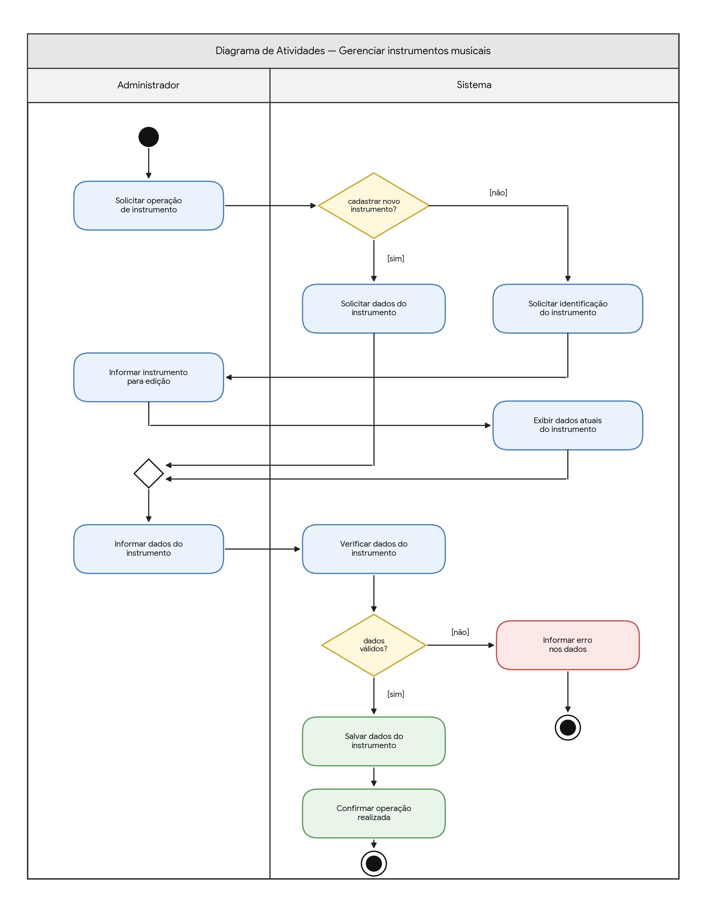

# 4.2.5 Modelagem de Atividade

## Do fluxo ao diagrama

O diagrama de atividades é o fluxo da 4.2.2 desenhado. A fonte é a especificação de Gerenciar instrumentos musicais: o fluxo principal, o alternativo A1 e a exceção E1. Nada entra no desenho que não esteja lá.

Três regras de tradução. Cada passo vira uma ação, na raia de quem faz. Cada "o sistema confirma" ou "o sistema verifica" vira uma ação seguida de uma decisão, porque verificar é perguntar. E cada alternativo ou exceção vira uma saída da decisão: o alternativo volta ao fluxo por uma junção, a exceção termina num fim próprio.

| No fluxo da 4.2.2 | Vira | Raia | Por quê |
|---|---|---|---|
| passo 1: o administrador solicita o cadastro de um instrumento | ação **Solicitar operação de instrumento** e decisão _cadastrar novo instrumento?_ | Administrador / Sistema | inicia o fluxo e separa o cadastro (fluxo principal) da edição (A1) |
| passo 2: o sistema solicita os dados do instrumento | ação **Solicitar dados do instrumento** | Sistema | resposta do sistema quando a saída [sim] da primeira decisão é seguida |
| A1: o administrador deseja editar um instrumento, o sistema solicita identificação, o administrador informa e o sistema apresenta os dados atuais | saída [não] da primeira decisão, ações **Solicitar identificação do instrumento** (Sistema), **Informar instrumento para edição** (Administrador) e **Exibir dados atuais do instrumento** (Sistema), além de uma **junção** | Sistema / Administrador | alternativo é desvio que volta. A junção une o caminho da edição ao caminho principal antes de preencher os dados |
| passo 3: o administrador informa nome, tipo, marca, modelo, preço e quantidade em estoque | ação **Informar dados do instrumento** | Administrador | ação do ator (vale tanto para o cadastro quanto para os novos dados da edição) |
| passo 4: o sistema verifica os dados informados | ação **Verificar dados do instrumento** e decisão _dados válidos?_ | Sistema | verificar é perguntar. A exceção E1 sai do [não] |
| E1: dados obrigatórios incompletos ou inválidos, o sistema informa erro e não salva | saída [não], ação **Informar erro nos dados** e um **fim** próprio | Sistema | exceção não volta. O caso termina sem a pós-condição, e o fim diz isso |
| passo 5: o sistema registra o instrumento | ação **Salvar dados do instrumento** | Sistema | consolida o cadastro ou a atualização dos dados no sistema |
| passo 6: o sistema confirma o cadastro do instrumento | ação **Confirmar operação realizada** e o **fim** do caminho feliz | Sistema | o passo que entrega a pós-condição. É o único fim com ela |

## Diagrama de atividades

**Figura 3 – Diagrama de atividades de Gerenciar instrumentos musicais**

Fonte: Autoria própria (2026).

A Figura 3 tem duas raias. A da esquerda é do **Administrador**, a da direita é do **Sistema**. Cada ação está na raia de quem a faz, e as setas cruzam de uma raia para a outra toda vez que a vez passa de um para o outro. Lendo de cima para baixo, o desenho traduz o fluxo de gerenciamento da 4.2.2.

O círculo cheio no alto é o **início**. Logo após a primeira decisão, há uma **junção**, o losango sem pergunta: é por ali que o caminho do A1 volta ao fluxo principal, depois de localizar e exibir os dados atuais do instrumento a ser editado. As duas **decisões** são os losangos com pergunta, e cada uma tem duas saídas com a guarda entre colchetes: [sim] e [não].

Na primeira decisão (*cadastrar novo instrumento?*), a saída `[sim]` segue para **Solicitar dados do instrumento**, enquanto a saída `[não]` desvia para o fluxo alternativo A1 (**Solicitar identificação do instrumento**, **Informar instrumento para edição** e **Exibir dados atuais do instrumento**), retornando pela junção antes de **Informar dados do instrumento**. Na segunda decisão (*dados válidos?*), a saída `[sim]` prossegue para salvar e confirmar a operação, enquanto a saída `[não]` aciona a exceção E1 (**Informar erro nos dados**).

Há dois **fins**. O de baixo, na raia do Sistema, é o único em que a pós-condição acontece: o instrumento cadastrado ou atualizado e a operação confirmada. O da direita é o fim da exceção E1, que encerra o caso quando há dados obrigatórios incompletos ou inválidos. Um caso de uso que pode terminar de dois jeitos tem dois fins; juntar tudo num fim só esconderia a falha.

Não há barra de sincronização (as duas barras grossas que separam e juntam caminhos paralelos). Nada em Gerenciar instrumentos musicais acontece ao mesmo tempo: é uma interação sequencial, uma etapa depois da outra. O símbolo não entra para enfeitar.

## Rastreabilidade com a 4.2.2

| Elemento do diagrama | Vem de | Confere |
|---|---|---|
| Solicitar operação de instrumento, Informar dados do instrumento | passos 1 e 3 (o administrador) | duas ações na raia do ator, referentes à solicitação e ao preenchimento dos dados |
| Solicitar dados do instrumento, Verificar dados do instrumento, Salvar dados do instrumento, Confirmar operação realizada | passos 2, 4, 5 e 6 (o sistema) | quatro ações na raia do sistema; a verificação corresponde à operação `validarDados()` da classe `Instrumento` na 4.2.3 |
| cadastrar novo instrumento? [sim] | passo 1 do fluxo principal (opção de cadastro) | segue diretamente para a solicitação dos dados do novo instrumento |
| cadastrar novo instrumento? [não] | fluxo alternativo A1 (opção de edição) | desvia para **Solicitar identificação do instrumento**, **Informar instrumento para edição** e **Exibir dados atuais do instrumento**, voltando pela junção |
| dados válidos? [não] | exceção E1 (no passo 4) | aciona **Informar erro nos dados** e termina em fim próprio, sem atingir a pós-condição |
| fim com a pós-condição | pós-condição da 4.2.2 | só o caminho feliz (cadastro ou atualização confirmada) chega nele |

**Todo passo tem elemento.** Os seis passos do fluxo principal, o alternativo A1 e a exceção E1 estão no desenho, e nenhum elemento do diagrama veio de fora da especificação. Se uma ação aparecesse sem passo correspondente, o ajuste teria de ser feito na 4.2.2.

**Toda decisão tem as duas saídas.** Cada losango com pergunta tem um `[sim]` e um `[não]`, e cada saída leva exatamente a um caminho da especificação: o fluxo principal, o alternativo A1 ou a exceção E1.

**O que o desenho mudou.** O passo 1 da 4.2.2 começa direto com "o administrador solicita o cadastro", deixando a edição apenas no fluxo alternativo A1. Desenhar o fluxo mostrou que a escolha entre cadastrar ou editar acontece logo na primeira decisão (*cadastrar novo instrumento?*) e que tanto o cadastro quanto a edição passam pela mesma etapa de preenchimento e validação dos dados antes de salvar.
